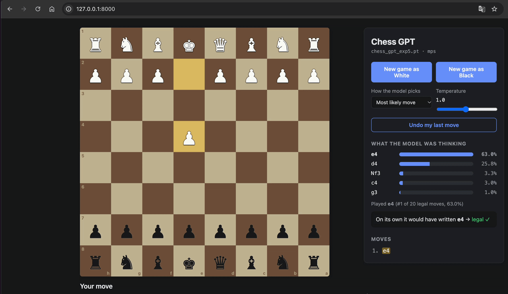

# Chess GPT


A **character-level** GPT (decoder-only Transformer, the architecture from
*Attention Is All You Need*) trained from scratch on Lichess games in algebraic
notation (`1.e4 e5 2.Nf3 Nc6 ...`). The model never sees a board, a piece list, or any
explicit chess rule — it learns to play purely by predicting the next character of a
game, exactly like a language model.

The project also includes an engine that turns those character predictions into a
*legal* chess player, a web UI to play against it in the browser, and an evaluation
pipeline to compare checkpoints across experiments.

## Demo



You play on a normal board in the browser. After each model move, the side panel shows
its top-5 candidate moves with their probabilities, plus what it would have written
"freely" without the legality constraint — useful to see when the model actually "knows"
the right move versus when it just got lucky among the legal options.

## Transformer architecture

`src/chess_gpt/model.py` implements a nanoGPT-style GPT with no dependency on
`transformers` or any high-level framework — the whole architecture (~150 lines) is
plain `torch.nn`:

| Component | Description |
|---|---|
| **Tokenization** | Character-level: the vocabulary is the set of unique characters in the training text (33 symbols — digits, piece/file/rank letters, `x`, `+`, `#`, `.`, space, newline). No BPE, no subwords. |
| **Embeddings** | A token embedding table (`vocab_size → n_embd`) plus learned absolute position embeddings (`block_size → n_embd`), summed elementwise. |
| **Transformer blocks** | `n_layer` blocks, each: pre-LayerNorm → causal multi-head self-attention → residual connection → pre-LayerNorm → MLP (`4×n_embd` hidden size, ReLU) → residual connection. |
| **Causal self-attention** | Each head projects Q/K/V, computes `softmax(QKᵀ/√d_k)` masked with a lower-triangular matrix (`tril`) so every position only attends to the past, then the heads are concatenated and projected back with a linear layer + dropout. |
| **Output head** | Final LayerNorm + linear projection to `vocab_size` logits, trained with cross-entropy against the next character. |
| **Generation** | `generate()` does standard autoregressive sampling (multinomial over the softmax), cropping the context to the last `block_size` tokens on every step. |

Hyperparameters (`n_embd`, `n_head`, `n_layer`, `block_size`, `dropout`) and the exact
vocabulary (`chars`) used at training time are saved inside each checkpoint, so any
experiment can be loaded without having to reconstruct its configuration by hand
(`cargar_modelo()` in `model.py`).

### Model sizes trained so far

| Checkpoint | `n_embd` | `n_head` | `n_layer` | `block_size` | `dropout` | Parameters |
|---|---|---|---|---|---|---|
| `chess_gpt`, `exp1`, `exp2`, `exp3` | 192 | 6 | 4 | 256 | 0.2 | ~3.4M |
| `exp4`, `exp5` | 256 | 6 | 6 | 256 | 0.1 | ~7.2M |

## How the model was trained

**Data.** Games come from the public [Lichess database](https://database.lichess.org/)
(standard-rated games, January–June 2013). Each PGN is parsed and filtered to keep only
games that are:
- rated, with both players' Elo known,
- terminated normally (no aborts/disconnects),
- not Bullet,
- free of inline engine evaluations (`{...}` annotations),
- and have an average Elo ≥ 1600 — to bias the training set towards fewer blunders.

The surviving games are written out move-sequence-only (`1.e4 e5 2.Nf3 ...`, no headers,
one game per line), then split into `train.txt` / `val.txt`. This plain text is the
*entire* training signal — no board representation, no engine annotations, no reward
model.

**Batching.** Rather than slicing `block_size`-token windows at random byte offsets
(which could start a batch mid-game), the data loader only samples windows that start
right after a `\n`, i.e. **every training example begins at the start of a real game**
(`1.`…). This was a deliberate experiment change (see `exp2` vs. earlier checkpoints) to
stop the model from learning to continue arbitrary mid-game fragments and instead anchor
it to the actual start-of-game distribution.

**Optimization.**
- Optimizer: `AdamW`, learning rate `3e-4`, no LR schedule or warmup.
- `batch_size = 32` sequences per step, `block_size = 256` characters of context.
- `max_iters = 10000` training steps; loss evaluated on train/val every `eval_interval
  = 500` steps, averaged over `eval_iters = 200` batches.
- Loss: cross-entropy over the predicted next character.
- Device auto-selected at runtime: CUDA → Apple MPS → CPU.
- Fixed seed (`torch.manual_seed(1337)`) for reproducibility.
- No weight decay tuning, no gradient clipping, no mixed precision — a deliberately
  minimal nanoGPT-style training loop, not a production LLM recipe.

Different experiments (`exp0`…`exp5`) sweep model size (`n_embd`/`n_head`/`n_layer`),
dropout, and the game-boundary-aligned batching described above; results for each are
compared by `scripts/evaluate_all.py` (see below).

### From raw text to a legal move (`engine.py`)

The model by itself **does not guarantee legality** — it only continues text.
`Motor.puntuar()` solves this by scoring, in a single forward pass, the log-probability
the model assigns to **every legal move in the current position** (enumerated with
`python-chess`): it concatenates the game-so-far prefix with each candidate move,
sums the character-by-character log-softmax of the candidate, and ranks all legal moves
by probability. This lets the engine always play the most likely move (`modo="mejor"`)
or sample from that distribution (`modo="muestrear"`), without ever letting the model
"hallucinate" an impossible move. Separately, `escribir_libre()` lets the model write
unconstrained, purely for diagnostics — comparing how often its free choice matches a
real legal move.

### Validation and diagnostics (`rules.py`)

A PyTorch-independent module that validates generated games with `python-chess`. It
classifies errors by their concrete cause rather than just "illegal": false capture
marker, `+`/`#` that don't match the actual check/mate, impossible castling, piece that
no longer exists, square occupied, a move that would leave its own king in check, etc.
This is what `scripts/evaluate_all.py` uses to measure, per experiment, the average
number of half-moves (plies) the model generates before its first mistake.

## Frontend (play UI)

`src/chess_gpt/web/` is a minimal **Flask** server exposing a JSON API and serving a
static single-page app with no frontend framework (plain HTML + CSS + JS, no build
step):

- **Backend (`web/__init__.py`)**: a single in-memory game, guarded by a `Lock` for
  concurrent requests. Routes `GET /api/estado`, `POST /api/nueva`, `POST /api/jugar`,
  `POST /api/deshacer`; each returns the full game state (piece map, turn, legal moves
  in UCI, the model's latest analysis, etc.), which keeps the frontend stateless beyond
  the currently selected square.
- **Frontend (`web/static/app.js`)**: ~200 dependency-free lines. It draws the board
  from the received JSON (flipping orientation based on the human player's color),
  handles origin → destination clicks validated against `estado.legales`, resolves
  promotion (defaults to queen when several options exist), and renders the analysis
  panel with probability bars for the model's top-5 candidate moves.
- Controls for the model's decision mode (most-likely move vs. probability sampling) and
  a temperature slider (0.1–2.0), sent with every request.
- All chess rules live server-side (`python-chess`); the frontend only renders data and
  never decides legality on its own.

## Installation

```bash
python -m venv .venv && source .venv/bin/activate
pip install -e ".[dev]"
```

`-e` installs the package in editable mode: changes in `src/` are picked up without
reinstalling.

## Project structure

```
src/chess_gpt/    📦 reusable code (imported as a package)
  model.py          GPT architecture + cargar_modelo
  rules.py          validation: legality, captures, checks, error causes
  engine.py         turns the GPT into a player: scores legal moves
  web/              Flask server + board UI
scripts/          ▶ entry points
  evaluate_all.py   evaluates every checkpoint → resultados.json
  play.py           play against the model in the browser
tests/            pytest suite
models/           .pt checkpoints (not tracked in git, see below)
```

## Usage

```bash
pytest                                  # run the test suite
python scripts/play.py                  # play → http://127.0.0.1:8000
python scripts/evaluate_all.py          # comparison table across experiments
```

## Model checkpoints

The `.pt` files in `models/` are **not committed to this repository** (see
`.gitignore`): they're 13–27 MB each and are reproducible from training, so versioning
them in git isn't worth the repo bloat. To play or evaluate you need at least one
checkpoint in `models/` — either downloaded from this repository's
[Releases](../../releases), or produced with your own training run.

`scripts/play.py` defaults to `models/chess_gpt_exp5.pt`; point it at another checkpoint
with `--checkpoint`.

### Publishing a checkpoint as a Release asset

Large binary files like `.pt` checkpoints shouldn't go into regular git commits (they'd
bloat the repo's history forever), but GitHub Releases let you attach arbitrary files
(up to 2 GB each on github.com) without that cost — they're stored separately from the
git history.

**Via the web UI:**
1. Push your code to GitHub first (`git init`, commit, `git remote add origin ...`,
   `git push`).
2. Go to your repo → **Releases** (right sidebar) → **Draft a new release**.
3. Pick or create a tag (e.g. `v0.1.0`), add a title/description.
4. Drag and drop the `.pt` file(s) into the **"Attach binaries"** box at the bottom.
5. Click **Publish release**. The file is now downloadable at a stable URL under
   `https://github.com/<user>/<repo>/releases/download/<tag>/<filename>`.

**Via the `gh` CLI** (faster once the repo is pushed):
```bash
gh release create v0.1.0 models/chess_gpt_exp5.pt \
  --title "exp5 checkpoint" \
  --notes "Best-performing checkpoint: 256-dim, 6 heads, 6 layers."
```
You can attach more files to an existing release later with:
```bash
gh release upload v0.1.0 models/chess_gpt_exp4.pt
```
